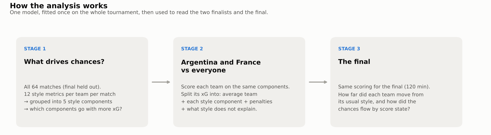
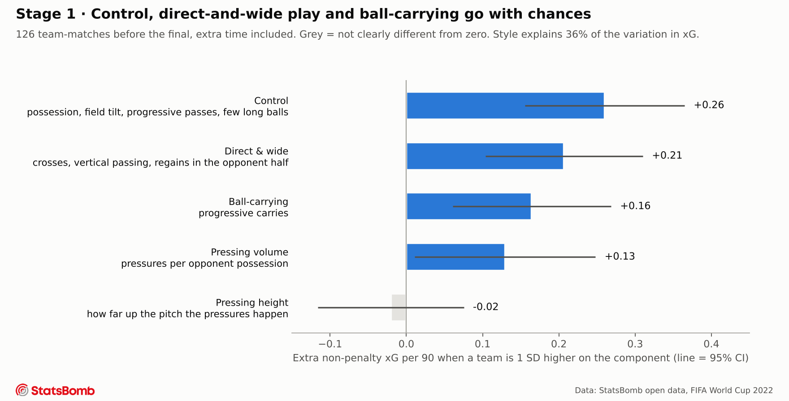
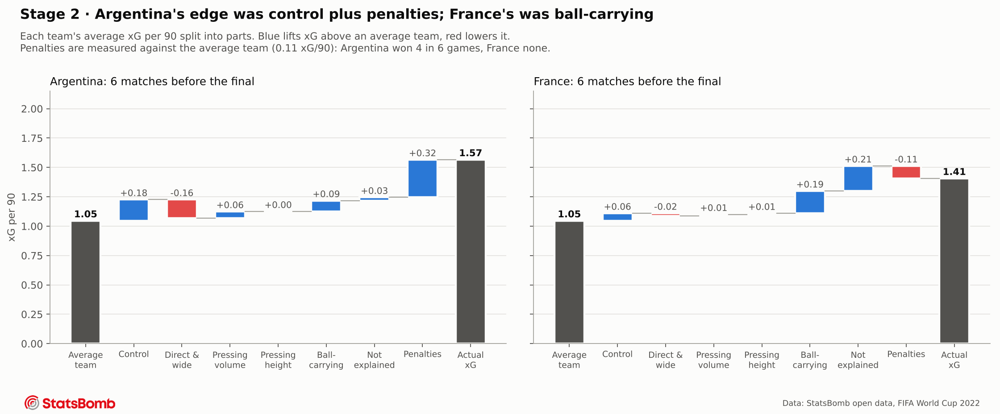
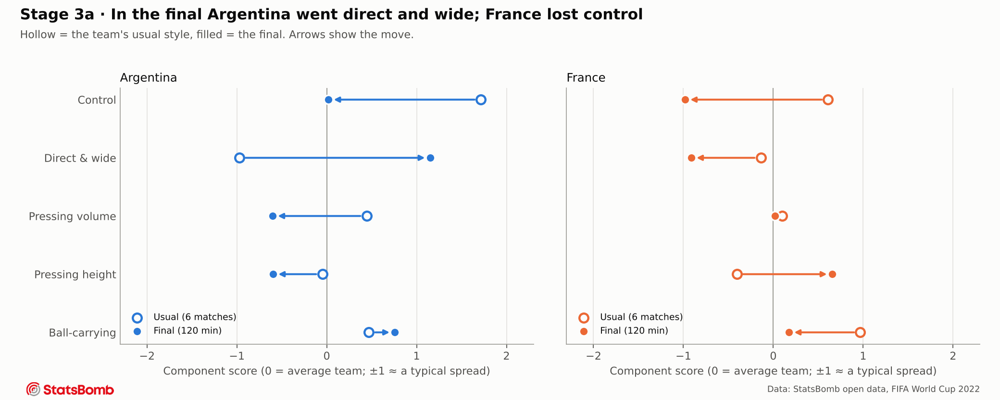
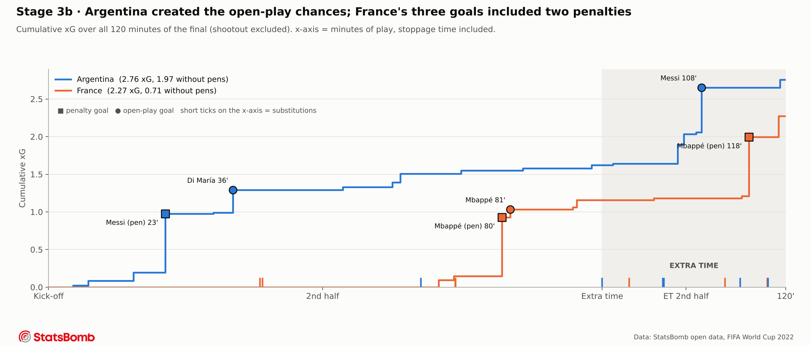

# What drives chance creation at the 2022 World Cup, and how Argentina and France fit the pattern

**Question:** which playing-style traits go with creating more chances at the 2022 World Cup? Where did
the two finalists sit on those traits, and what changed in the final (Argentina 3–3 France after extra
time; Argentina won on penalties)?

**In one paragraph:** across the tournament, teams that **controlled the ball**, **went direct and wide**,
or **carried the ball forward** created more chances; how high a team pressed made no difference.
Argentina's edge before the final was control **plus penalties**: they won four in six games, and
without them their chances were exactly what their style predicts. France's edge was ball-carrying, the
best of all 32 teams. In the final, Argentina dropped their usual control and played direct and wide.
France were pushed off both control and carrying. Over 120 minutes Argentina created **1.97 open-play
xG to France's 0.71**; two of France's three goals were penalties.



> **xG (expected goals)** = the probability a shot is scored, from the shot's location and type. Summed
> over a match, it measures how many good chances a team created. A penalty is worth about 0.78 xG.

---

## Stage 1: what drives chances across the tournament?

**What we did.** For every team in every match before the final (126 team-matches, extra time included),
we computed 12 style metrics: how much of the ball it had, how it moved the ball forward, where it
played, and how it pressed. Many of these move together; for example, teams with more possession also
make more progressive passes. **PCA** (principal component analysis) groups metrics that move together
into a few independent **style components**. Five components capture 85% of how teams differ. We then
asked how much each component moves a team's **non-penalty xG** per 90 minutes. Penalties are not a
style trait, so they are added back separately in Stage 2.



**Result.**
- **Control** has the biggest link to chances: +0.26 xG per 90 for a team one standard deviation more in
  control. Control here means possession, field tilt, progressive passes and few long balls.
- **Direct & wide** play follows (+0.21), then **ball-carrying** (+0.17) and **pressing volume** (+0.13).
- **Pressing height** has no link at all (−0.02).
- An average team made 1.05 xG per 90 (0.11 of it from penalties). Style explains 36% of the differences
  in xG; the rest is player quality, set pieces and luck.

## Stage 2: Argentina and France compared with everyone

**What we did.** We scored every team on the same five components, averaged over its matches before the
final. We then split each team's xG into a sum of parts: what an average team makes, plus what each style
component adds or takes away, plus penalties, plus whatever style does not explain.



| Rank among 32 teams | Argentina | France |
|---|---|---|
| xG per 90 | **3rd** (1.57) | 5th (1.41) |
| xG predicted from style | 6th | 4th |
| Control | 6th | 12th |
| Direct & wide | **31st** | 21st |
| Pressing volume | 5th | 13th |
| Ball-carrying | 3rd | **1st** |

**Result.**
- **Argentina** were a control team (+0.18) that almost never went direct or wide (31st of 32, −0.16).
  The biggest single part of their total was **penalties: four won in six games, +0.32 xG per 90** above
  an average team. Take the penalties out and their chances match their style almost exactly
  (+0.03 unexplained).
- **France** got their edge from **ball-carrying** (+0.19, the most of any team). They also created
  +0.21 more than their style predicts, which points to individual quality in the final third. They won
  no penalties before the final.

> **Predicted vs actual:** the predicted value is what a team with that style usually creates at this
> tournament. The gap is not "playing differently". It is getting more (or less) out of the same way of
> playing: penalties, individual quality, set pieces, or luck.

## Stage 3: the final, all 120 minutes

**What we did.** We scored the final on the same components and compared each team with its own usual
style. We then followed the chances through the match on a cumulative xG timeline. Extra time is part of
the analysis, not an afterthought. It is shaded on the timeline and is its own window in the score-state
table below.



**Result: both teams moved away from their usual style.**
- **Argentina** went from their usual high control (+1.72) to average (0.02), and from the second-least
  direct team (−0.97) to strongly **direct and wide** (+1.15). Their style still predicted 1.22
  open-play xG per 90, and they made 1.26: the style change kept producing chances.
- **France** lost **control** (+0.61 → −0.98) and most of their usual **ball-carrying** (+0.97 → +0.17).
  They pressed higher than usual, but Stage 1 shows that does not create chances. Their style predicted
  only 0.71 open-play xG per 90, and they made 0.45.



| Phase of the final | Argentina xG | France xG | What changed |
|---|---|---|---|
| 0–22' (0–0) | 0.19 | 0.00 | Argentina 59% of passes |
| 22–79' (Argentina lead) | 1.35, incl. 0.78 pen | 0.15 | France press higher (58 vs 55 on the x-axis) but create nothing |
| 79–90' (France comeback) | 0.07 | 1.01, incl. 0.78 pen | France press at 64.6, Argentina drop to 38.2; France triple their carries |
| 91–120' (extra time) | 1.14, open play (8 shots) | 1.11, incl. 0.78 pen (3 other shots) | Argentina back on top: 63% of passes |

**Result.**
- Argentina created the open-play chances in three of the four phases: 1.97 open-play xG to France's
  0.71 over the match.
- France's comeback was a short, intense spell: about 19 minutes of high pressing and carrying, which
  produced a penalty and Mbappé's volley 97 seconds apart.
- In **extra time** Argentina took control back and created 1.14 open-play xG from 8 shots. France's
  answer was a penalty.

---

## Method in brief

| Step | Detail |
|---|---|
| Data | StatsBomb open data, FIFA World Cup 2022: 64 matches, 234,637 events. Match IDs are looked up, not hard-coded. |
| Unit | One row per team per match, **all periods including extra time**, shootouts excluded. Rates are per 90 minutes actually played. The final is held out of the baseline. |
| 12 metrics | Build-up: possession share, passes per possession, pass completion under pressure. Progression: progressive passes /90, progressive carries /90, directness, long-ball share. Territory: field tilt, crosses per final-third entry. Pressing: pressures per opponent possession, pressure height, regains in the opponent half /90. **None use shots or xG**, so the outcome cannot leak into the inputs. Exact definitions are in `src/metrics.py`. |
| Model | Standardise the metrics → PCA, keeping 5 components (85% of variance) → linear regression of non-penalty xG per 90 on the components. Standard errors are clustered by match, because each match appears twice. |
| Breakdown | Average team + (coefficient × team's component score) for each component + penalties vs average + unexplained = actual xG. |
| Checks | Goals per team-match agree with the shot data for all 128 rows, and the final reads 3–3. Goal and substitution times come from the events, not memory. |

## Limitations

- **Small samples.** Seven matches per finalist and one final. The phase windows in Stage 3 are short (19
  minutes for the comeback), so the table reports raw xG and shot counts, not only rates.
- **Association, not cause.** Better teams have the ball more because they are better. The model says
  which traits go with chances at this tournament, not that copying them would create chances.
- **Game state.** Argentina led for 57 of the first 90 minutes of the final, so part of their style
  change is the scoreline. The phase table is the only score-state control.
- **No opponent adjustment.** The two finalists faced different opponents on the way to the final.
- **Event data only.** Off-ball shape (defensive line height, compactness) would need tracking data.

## Why 2022 and not 2026

The original idea was Argentina's comebacks at the 2026 World Cup, but event-level data for 2026 is not
publicly available: StatsBomb's open data stops before 2026, and FIFA's post-match reports only give
aggregates. The 2022 final asks the same kind of question and has full open data.

## Future scope

A closer look at the final's turning points:
- pass networks before and after France's 41' double substitution and Di María's exit at 64';
- who took over Argentina's left side;
- defensive line height from StatsBomb 360 frames;
- full tracking data (PFF FC provides it for all 64 matches on request).

## Reproduce

```bash
pip install -r requirements.txt
jupyter nbconvert --to notebook --execute --inplace notebooks/analysis.ipynb
```

The first run downloads and caches the events in `data/` (gitignored). The code is in `src/`:
- `data.py`: loading;
- `metrics.py`: the 12 metrics;
- `model.py`: PCA, regression and breakdown;
- `final.py`: the final's phases and timeline;
- `plots.py`: the figures.

`notes/00_data_dictionary.md` lists every field in the data.

## Data credit


Data provided by [StatsBomb](https://github.com/statsbomb/open-data) open data, used under their
non-commercial licence.
