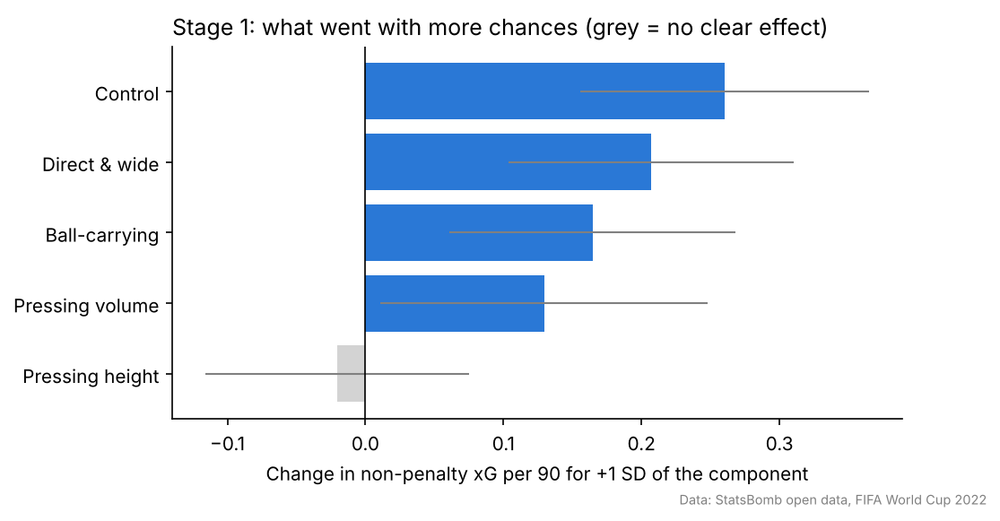
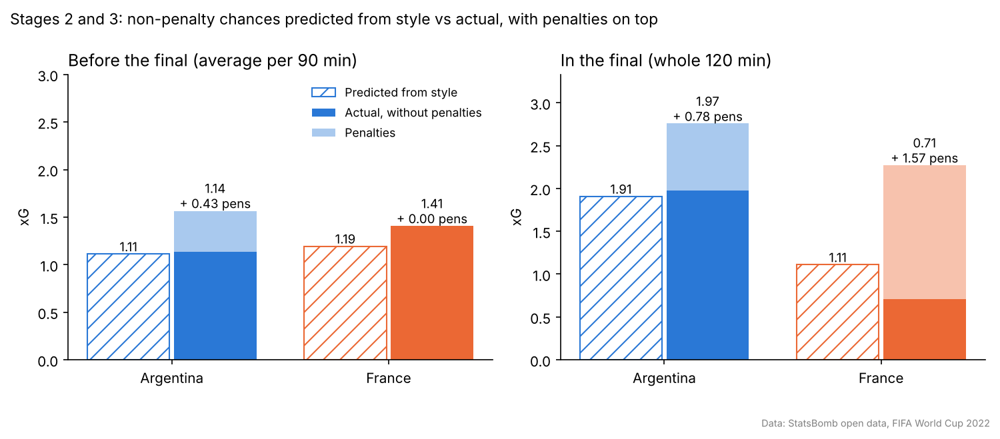
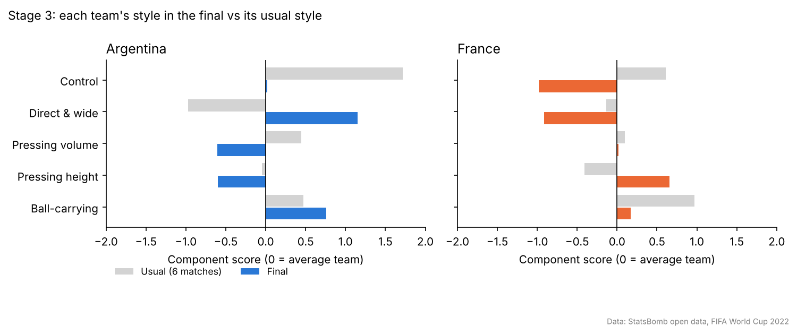
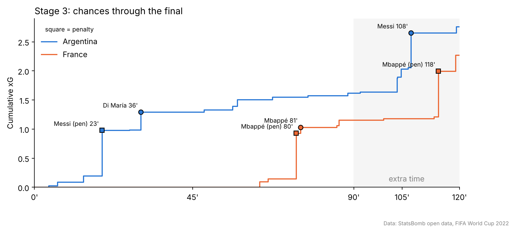

# What drove chance creation at the 2022 World Cup

**Question:** which playing styles created more chances at the 2022 World Cup, how did Argentina and
France fit that pattern, and what changed in the final?

**Short answer:** teams that controlled the ball, went direct and wide, or carried the ball forward
created more chances; how high a team pressed made no difference. Argentina were a control team whose
chances matched their style, and on top of that they won four penalties in six games. France were the
tournament's best ball-carriers. In the final, France were pushed off their style and created very little
from open play; two of their three goals were penalties.

## How the analysis worked

The measure of chances is **xG** (expected goals): the probability that a shot is scored. Summed over a
match, it shows how many good chances a team created.

**How penalties were handled (the same rule in every stage):** a penalty is worth about 0.78 xG however a
team plays, so it tells us nothing about style. The style model was therefore built on **non-penalty xG**
(every shot except penalties). Penalty xG was never fed into the model; it is shown separately, stacked
on top of the actual non-penalty xG, so you can see how much each team's total depended on penalties.

1. **Stage 1, the tournament.** For each team in each match before the final (126 team-matches, extra
   time included, shootouts excluded), 12 style metrics were measured: possession, passing, ball
   progression, crossing and pressing. Many of these move together, so PCA (principal component
   analysis) grouped them into 5 **style components**. A regression then measured how much each
   component went with non-penalty xG.
2. **Stage 2, the finalists.** The Stage 1 model turned each team's style into a **predicted**
   non-penalty xG. Argentina's and France's predictions were compared with what they actually created,
   with their penalties shown on top.
3. **Stage 3, the final.** The same comparison for the final (all 120 minutes), plus how each team's
   style changed from its usual one, and when the chances came.

## Stage 1: what went with more chances



- **Control** (possession, field tilt, progressive passes) had the strongest link: +0.26 non-penalty xG
  per 90 minutes for a team one standard deviation above average.
- **Direct & wide** play (+0.21), **ball-carrying** (+0.17) and **pressing volume** (+0.13) followed.
- **Pressing height** had no link (−0.02).
- Style explained about a third of the differences in chances (R² = 0.36). The rest came from player
  quality, set pieces and luck.
- **Chances are not results.** Possession went with more chances (correlation 0.31) but not with more
  points (−0.08). This matches what commentators noticed at the time: Spain kept the ball more than
  anyone yet created less than their style predicted (0.86 vs 1.17 non-penalty xG per 90), and
  low-possession Morocco reached the semi-finals.

## Stages 2 and 3: predicted vs actual, and the role of penalties



**Before the final (left):**
- **Argentina's** open-play chances matched their style almost exactly (1.14 actual vs 1.11 predicted
  per 90). What lifted them to the 3rd-highest xG of the tournament was **penalties**: four won in six
  games, adding 0.43 xG per 90.
- **France** created more than their style predicted (1.41 vs 1.19) and won no penalties. Their style
  was built on ball-carrying, where they ranked 1st of 32.

**In the final (right):**
- **Argentina's** chances again matched their style: 1.97 open-play xG against 1.91 predicted, plus one
  penalty (0.78).
- **France's** style in the final predicted only 1.11, and they created 0.71 from open play. Their two
  penalties (1.57) were worth more than all their open-play chances combined.

## Stage 3: what changed in the final



- **Argentina** gave up their usual control and played far more direct and wide than they normally did.
  This was the plan: Scaloni started Di María on the left to attack Koundé. Di María won the first
  penalty, scored the second goal, and made 6 of Argentina's 12 crosses in the first 90 minutes.
- **France** lost both control and their usual ball-carrying, and had **no shot at all in the first
  half**. They pressed higher than usual, but Stage 1 showed that pressing height did not create
  chances.



- Argentina created most of their chances while Di María was on: 0.72 non-penalty xG before he went
  off at 64', and 0.11 in the 26 minutes after.
- France's comeback came in a short burst after Deschamps' substitutions: Kolo Muani (on at 41') won the
  penalty, and Thuram (also on at 41') set up Mbappé's volley 97 seconds later.
- In **extra time**, Argentina created 1.14 open-play xG from 8 shots; France's main chance was a
  penalty.

## How this compares with other analysis

The findings agree with what was written about the tournament and the final at the time:

| Common view | What this analysis found |
|---|---|
| Possession mattered less for winning in 2022 ([ESPN](https://www.espn.co.uk/football/fifa-world-cup/story/4832549/2022-world-cup-tactical-trends-do-you-even-need-possession)) | Possession went with chances, not with points; Spain created less than their style predicted |
| More attacking play went down the wings ([ESPN](https://www.espn.co.uk/football/fifa-world-cup/story/4832549/2022-world-cup-tactical-trends-do-you-even-need-possession)) | Direct and wide play was the second-strongest driver of chances |
| Argentina won a record five penalties at one World Cup ([FourFourTwo](https://fourfourtwo.com/news/how-many-penalties-have-argentina-and-lionel-messi-had-at-world-cup-2022)) | Four before the final and one in it; penalties were what lifted Argentina's xG above their style |
| Argentina targeted Koundé with Di María on the left ([Coaches' Voice](https://learning.coachesvoice.com/cv/world-cup-final-2022-tactics-argentina-messi-france-mbappe/), [Breaking The Lines](https://breakingthelines.com/world-cup-2022/tactical-analysis-argentina-3-3-france/)) | Argentina turned direct and wide in the final; their chances dropped once Di María went off |
| France had no shot in the first half, and the 41' changes turned the game ([NBC](https://www.nbcconnecticut.com/news/sports/soccer/world-cup-2022/olivier-giroud-ousmane-dembele-substituted-before-halftime-vs-argentina-in-world-cup-final/2938765/)) | Confirmed: 0 shots before half-time; both late France goals came through the two substitutes |
| Argentina dominated open-play chances; at 90' France had 0.29 non-penalty xG ([Sporting Life](https://www.sportinglife.com/football/news/xg-world-cup-final-review-according-to-expected-goals/206066), Infogol model) | 0.84 vs 0.37 non-penalty xG at 90' and 1.14 vs 0.33 in extra time (StatsBomb model; models differ slightly) |

## Limitations

- **Small samples:** seven matches per finalist and one final.
- **Association, not cause:** better teams have the ball more because they are better. The model shows
  which styles went with chances, not that copying a style would create them.
- **Game state:** Argentina led for most of the final, which partly explains their change of style.
- **Event data only:** off-ball shape would need tracking data.

## Why 2022 and not 2026

The original idea was Argentina's comebacks at the 2026 World Cup. Event-level data for 2026 is not
publicly available (StatsBomb open data stops before 2026, and FIFA's post-match reports only give
aggregates), so the 2022 final, which has full open data, was used instead.

## Reproduce

```bash
pip install -r requirements.txt
jupyter nbconvert --to notebook --execute --inplace notebooks/analysis.ipynb
```

`notebooks/analysis.ipynb` reproduces every number and chart in this README, including the full tables.
The code is in `src/`, and `notes/00_data_dictionary.md` lists every field in the data.

## Data credit


Data provided by [StatsBomb](https://github.com/statsbomb/open-data) open data, used under their
non-commercial licence.
