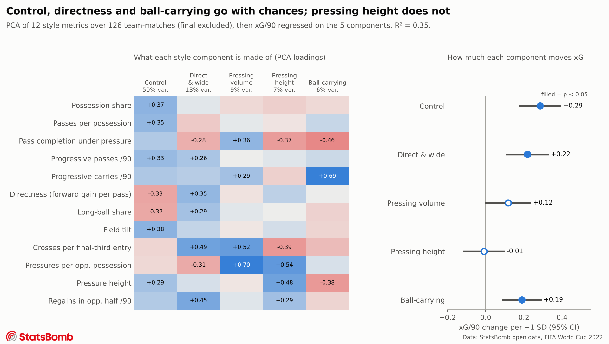
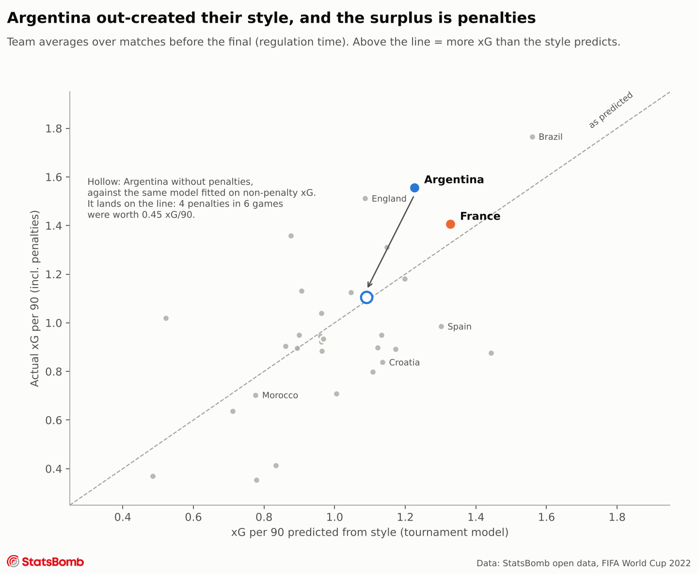
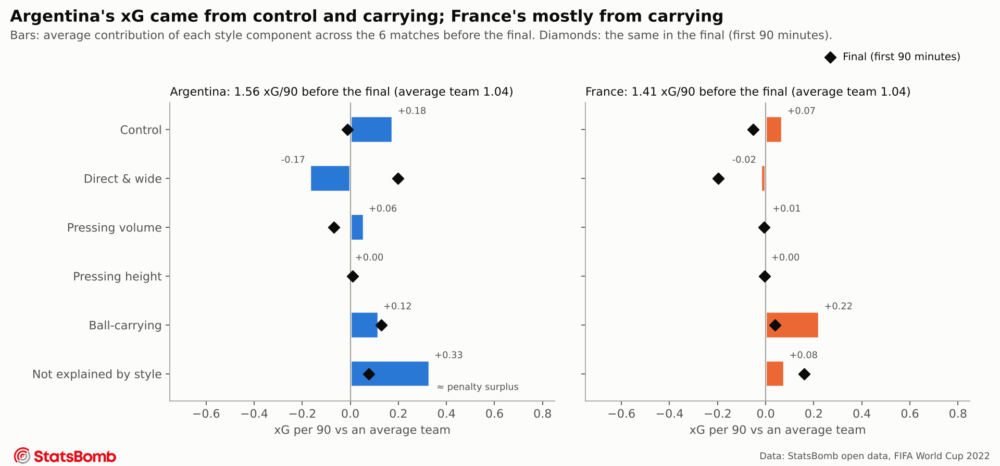
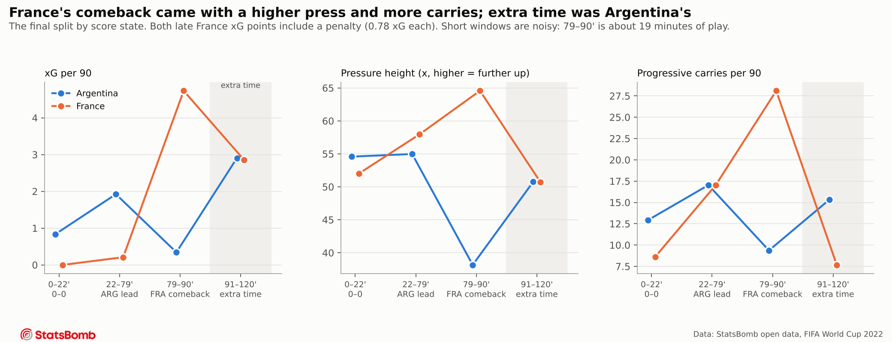

# What drives chance creation at the 2022 World Cup, and how Argentina and France fit the pattern

**The question.** Across all 64 matches of the 2022 World Cup, which playing-style traits go with creating
more expected goals (xG)? Where did the two finalists sit on those traits, and how did each team's
usual pattern hold up in the final?

**Why 2022 and not 2026.** The original idea was Argentina's comebacks at the 2026 World Cup. Event-level
data for 2026 is not publicly available: StatsBomb's open data stops before 2026, and FIFA's post-match
reports only give aggregates. The 2022 final (Argentina 3–3 France, Argentina won on penalties) asks the
same kind of question and has full open event data for every match.

---

## Key findings

### 1. Across the tournament, control, directness and ball-carrying go with chances; pressing height does not



Twelve style metrics reduce to five components that explain 85% of how teams differ. Regressing xG per 90
on those components explains **35% of match-to-match variation in xG** (R² = 0.35, 126 team-matches). For
a one-standard-deviation increase:

| Component | What it is | xG/90 change (95% CI) |
|---|---|---|
| **Control** | possession, field tilt, progressive passing, few long balls | **+0.29** (0.17 to 0.40) |
| **Direct & wide** | crosses, regains high up, vertical passing | **+0.22** (0.11 to 0.33) |
| **Ball-carrying** | progressive carries | **+0.19** (0.09 to 0.29) |
| Pressing volume | pressures per opponent possession | +0.12 (−0.00 to 0.24) |
| Pressing height | where the pressures happen | −0.01 (−0.12 to 0.10) |

An average team made 1.04 xG per 90. *Reading for staff:* how high a team pressed told us nothing about
how many chances it created; what it did with the ball did.

### 2. Argentina out-created their style, and the whole surplus is penalties



Before the final, Argentina made **1.56 xG per 90 (3rd of 32)**, while their style predicts 1.23
(6th). That gap of +0.33 is almost exactly their penalties: they won **4 penalties in 6 matches**
(Saudi Arabia, Poland, Netherlands, Croatia), worth 0.45 xG per 90. Refit the same model on
non-penalty xG and Argentina sit on the line (residual +0.01). France, with no penalties, beat their
non-penalty prediction by +0.22 (5th): their chances were better than their style alone suggests.

### 3. Argentina's chances came from control and carrying; France's mostly from carrying



Ranks among the 32 teams, matches before the final:

| Component | Argentina | France |
|---|---|---|
| Control | 8th | 12th |
| Direct & wide | **31st** (almost never direct) | 19th |
| Pressing volume | 5th | 13th |
| Ball-carrying | 3rd | **1st** |

Argentina's xG came from control (+0.18 per 90) and carrying (+0.12), held back by how rarely they played
direct or wide (−0.17). France's came mostly from carrying (+0.22), more than any other team's.

**In the final (first 90 minutes) Argentina changed shape.** Their "Direct & wide" score went from the
second-lowest in the tournament to +1.14, and crosses per final-third entry were 1.6 standard deviations
above their own norm. Di María made 6 of their 12 crosses, and 44% of their final-third entries went down
the left (33% in earlier games). France were pushed off both of their usual strengths: passes per
possession and progressive passes were both 1.3 SD below their own average, and carrying fell.
*Caveat: Argentina led for 57 of the 90 minutes, so some of this is game state, not plan.*

### 4. France's comeback came with a higher press and more carries; extra time was Argentina's



Extra time is treated separately, not as more of the same match. Split by score state:

- **22–79', Argentina leading:** Argentina 1.35 xG (0.78 of it Messi's penalty), France 0.15. France pressed
  higher than Argentina (58 vs 55 on the pitch's x-axis) but created almost nothing.
- **79–90', France's comeback:** in about 19 minutes France pressed at 64.6 (their highest of the match)
  while Argentina's pressing dropped to 38, deep in their own half. France made 1.01 xG in that window: a
  penalty (0.78) plus Mbappé's volley. Argentina made 0.07.
- **91–120', extra time:** Argentina took control back: 63% of passes, 1.14 open-play xG from 8 shots,
  against France's 0.33 from 3 (plus Mbappé's 117' penalty).

**Reading:** the 70' French changes and the 79–81' goals are confounded, since France were also chasing
the game. The data shows *what* changed (a higher press and more carrying), not which cause drove it.

---

## How to read "predicted vs actual"

The model is fitted once, on every team-match before the final. For any team or match, **predicted xG** is
what a team playing with that style usually creates at this tournament. **Actual minus predicted** (the
residual) is xG that style does not explain: penalties, individual quality (a shot from a better spot than
the style implies), set pieces, or noise. A positive residual is not "playing differently". It is
*getting more out of the same way of playing*. For Argentina that "more" was penalties. This also differs
from finishing: goals vs xG is a separate gap that this analysis does not model.

## Method

- **Data:** StatsBomb open data, FIFA World Cup 2022: 64 matches, 234,637 events. The competition and
  match IDs are looked up through `statsbombpy`, not hard-coded.
- **Unit:** one row per team per match, **regulation time only** (periods 1–2). The final is held out of
  the baseline (126 rows). Extra time is analysed separately and shootouts are excluded.
- **Target:** xG per 90 **including penalties**. A penalty-free version (npxG) is fitted as a check, and the
  coefficients barely move (R² 0.36 vs 0.35).
- **12 style metrics** (none use shots or xG, so the target cannot leak into the predictors):

| Pillar | Metric | Definition |
|---|---|---|
| Build-up | Possession share | Team share of all passes in the match |
| | Passes per possession | Open-play passes / team possessions |
| | Pass completion under pressure | Completion of open-play passes made under pressure |
| Progression | Progressive passes /90 | Completed open-play passes that cut the distance to goal by 25%+, starting outside own third |
| | Progressive carries /90 | Carries of 5+ units, same rule |
| | Directness | Mean forward gain (x) per open-play pass |
| | Long-ball share | Share of open-play passes of 35+ units |
| Territory | Field tilt | Team share of both teams' final-third passes |
| | Crosses per entry | Open-play crosses / final-third entries |
| Pressing | Pressures per opp. possession | Pressures / opponent possessions |
| | Pressure height | Mean x of pressures |
| | High regains /90 | Recoveries and won interceptions in the opponent half |

- **Model:** standardise the metrics, run a PCA, and keep the 5 components that explain 85% of the
  variance. Then fit an OLS of xG/90 on the components. Each match appears twice (once per team), so the
  standard errors are clustered by match.
- **Team breakdown:** a team's contribution from a component = coefficient × the team's average score on
  that component. The contributions plus the residual add up to the gap from the average team.
- **Checks:** regulation-time goals in the metric table match the shot data for every match. Argentina's
  match-by-match goals and penalties were checked by hand. Every substitution and goal time in the final
  comes from the events.

## Limitations

- **Small samples.** Seven matches per finalist; one final. Rates in short windows of the final (e.g. 19
  minutes) rest on a handful of events. The notebook reports counts next to rates.
- **Association, not cause.** Stronger teams have the ball more because they are stronger. The model says
  which traits go with chances at this tournament, not that adopting them creates chances.
- **No opponent adjustment.** Argentina's group (Saudi Arabia, Mexico, Poland) differs from France's.
- **Game state.** The final's 90-minute profile is dominated by Argentina leading. The window split
  (finding 4) is the only game-state control; the tournament baseline does not split by score.
- **Event data only.** Off-ball shape (defensive line height, compactness) needs tracking data. StatsBomb
  360 frames exist for every match but were left out to keep the scope tight.
- **Metric definitions are choices.** Thresholds (25% for progressive, 35 units for long) follow common
  practice but are not unique.

## Future scope

Micro-analysis of the final's breakpoints: pass networks before and after France's 41' double
substitution and Di María's 64' exit; who took over the left side; defensive line height from 360 frames;
and full tracking data (PFF FC publishes broadcast tracking for all 64 matches on request).

## Reproduce

```bash
pip install -r requirements.txt
jupyter nbconvert --to notebook --execute --inplace notebooks/analysis.ipynb
```

The first run downloads and caches the events in `data/` (gitignored). `src/` holds the data loading
(`data.py`), the metrics (`metrics.py`), the model (`model.py`), the final's score-state split
(`final.py`) and the figures (`plots.py`). `notes/00_data_dictionary.md` lists every field in the data.

## Data credit


Data provided by [StatsBomb](https://github.com/statsbomb/open-data) open data, used under their
non-commercial licence.
